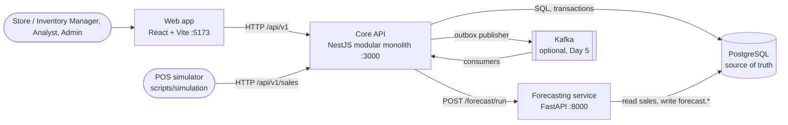
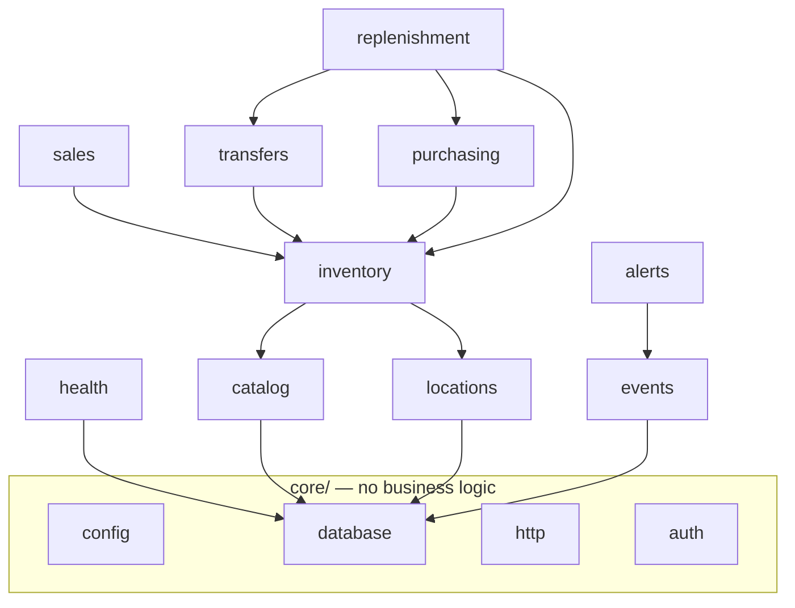
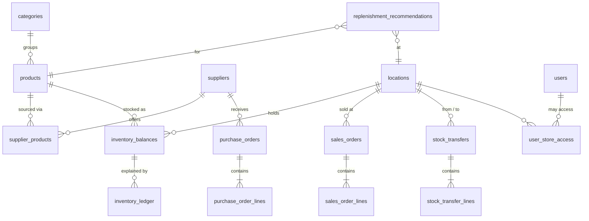
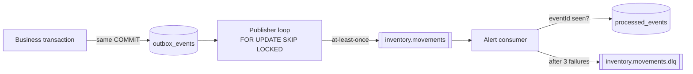
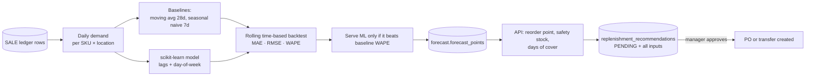

# RetailPulse — Architecture

This is the design every change must follow. If code and this document disagree, fix one of them
in the same change. Diagrams use Mermaid (renders on GitHub and in VS Code's Markdown preview
with the "Markdown Preview Mermaid Support" extension).

> All data is synthetic. RetailPulse is an independent portfolio project.

---

## 1. System context



| Component       | Owns                                             | Never does                                |
| --------------- | ------------------------------------------------ | ----------------------------------------- |
| Web             | UI, form validation for UX                       | Business rules, authorization decisions   |
| Core API        | All business rules, all writes to operational data | Long-running ML work                    |
| PostgreSQL      | Truth for stock, orders, ledger, recommendations | —                                         |
| Forecasting     | Demand models, backtests, `forecast.*` tables    | Writing inventory, orders or recommendations |
| Kafka (Day 5)   | Delivering committed events to consumers         | Being required for a sale to succeed      |

**Why a modular monolith:** one deployable API keeps transactions simple (a sale, its ledger
entry and its outbox event commit together). Modules give the separation of microservices
without network calls. Forecasting is separate only because it is a different runtime (Python).

---

## 2. Core API internal design

### 2.1 Layers (inside each module)

```text
HTTP request
  → Controller   parse + validate input (Zod), call one service method, map to response DTO
  → Service      business rules, transactions, authorization checks on objects
  → Repository   SQL only (pg). No business rules. Returns plain typed rows.
  → PostgreSQL
```

Rules:

1. **Only repositories contain SQL.** Controllers never touch the database.
2. **Services own transactions** via `DatabaseService.transaction(client => …)` and pass the
   `client` down to repositories so every query runs in the same transaction.
3. **Modules talk through exported services**, never another module's repository.
4. **Request schemas are Zod; response shapes are TypeScript interfaces**, both in
   `<module>.schemas.ts`. Repositories alias columns to the response shape (`on_hand AS "onHand"`);
   raw table rows are never returned.

### 2.2 Module map and allowed dependencies



- Arrows point at what a module may call. **No cycles.**
- **`inventory` is the only module that writes `inventory_balances` and `inventory_ledger`.**
  Sales, transfers, purchasing and adjustments all call `InventoryService.applyMovement()`.
- `events` writes the outbox *inside the caller's transaction* (it receives the `client`).

### 2.3 Cross-cutting behaviour (already in place)

| Concern          | Where                                      | Behaviour                                         |
| ---------------- | ------------------------------------------ | ------------------------------------------------- |
| Config           | `core/config/env.ts`                       | Zod-validated at boot; app refuses to start if invalid |
| DB access        | `core/database/database.service.ts`        | One `pg` pool, `query()`, `transaction()`, `ping()` |
| Correlation ID   | `core/http/correlation-id.middleware.ts`   | Accept or create `x-correlation-id`, echo it      |
| Errors           | `core/http/http-exception.filter.ts`       | `{ error: { code, message }, correlationId }`     |
| Versioning       | `bootstrap.ts`                             | Global prefix `/api/v1`                           |

---

## 3. The inventory write path (the most important flow)

Every stock change, whatever the cause, goes through one function:


Guarantees and how they are enforced:

| Guarantee                         | Enforced by                                                      |
| --------------------------------- | ---------------------------------------------------------------- |
| No oversell under concurrency     | Trigger's `UPDATE` row-locks the balance; CHECKs run on the locked row (tested with two racing sessions) |
| No negative stock                 | `CHECK (on_hand >= 0 AND reserved >= 0 AND reserved <= on_hand)` |
| Every change is traceable         | Balances change **only** via the ledger trigger; a guard trigger rejects direct `UPDATE`/non-zero `INSERT` on `inventory_balances` — enforced by the database, not just by code |
| Ledger can't be rewritten         | DB trigger rejects `UPDATE`/`DELETE` on `inventory_ledger`       |
| Movements go the right direction  | `ledger_delta_matches_type` CHECK (e.g. `SALE` must be negative, `RESERVATION` only touches reserved) |
| Retries don't double-apply        | `idempotency_keys` table, unique per (key, endpoint)             |
| Event published iff tx committed  | Outbox row in the same transaction (Day 5)                       |

Lock ordering: when a movement touches several balance rows (multi-line sale, transfer), lock
them in a fixed order (`product_id, location_id` ascending) to avoid deadlocks.

---

## 4. Data model

Conventions: `uuid` primary keys (`gen_random_uuid()`), `snake_case`, `created_at`/`updated_at`
as `timestamptz` (UTC), quantities as `integer` **units**, money as `numeric(12,2)`, status and
type columns as Postgres enums or `CHECK` lists.



### Tables by day

| Day | Tables                                                                                     |
| --- | ------------------------------------------------------------------------------------------ |
| 1   | `schema_migrations` (runner)                                                               |
| 2   | `categories`, `suppliers`, `products`, `supplier_products`, `locations`, `inventory_balances`, `inventory_ledger` |
| 3 ✅ | `sales_orders`, `sales_order_lines`, `reservations`, `idempotency_keys`                   |
| 4   | `stock_transfers`, `stock_transfer_lines`, `users`, `user_store_access`, `sessions`        |
| 5   | `outbox_events`, `processed_events`, `alerts`                                              |
| 6   | `purchase_orders`, `purchase_order_lines`, `replenishment_recommendations`, `forecast.forecast_runs`, `forecast.forecast_points` |

### Key table shapes

**`inventory_balances`** — one row per (product, location). PK `(product_id, location_id)`.
`on_hand int`, `reserved int`, `updated_at`. `available` is computed (`on_hand - reserved`), never stored.

**`inventory_ledger`** — append-only. `id`, `product_id`, `location_id`, `movement_type`,
`on_hand_delta int`, `reserved_delta int`, `on_hand_after int`, `reserved_after int`,
`reason text`, `reference_type`, `reference_id`, `correlation_id`, `actor_id`, `occurred_at`.
Invariant (tested): for every balance, `SUM(on_hand_delta) = on_hand` and `SUM(reserved_delta) = reserved`.

| Movement type         | on_hand_delta | reserved_delta |
| --------------------- | ------------- | -------------- |
| `RECEIPT`             | +q            | 0              |
| `SALE`                | −q            | 0              |
| `RETURN` (sellable)   | +q            | 0              |
| `ADJUSTMENT`          | ±q            | 0              |
| `RESERVATION`         | 0             | +q             |
| `RESERVATION_RELEASE` | 0             | −q             |
| `TRANSFER_OUT`        | −q            | 0              |
| `TRANSFER_IN`         | +q            | 0              |

Damaged returns are recorded with `reason = 'DAMAGED'` and `on_hand_delta = 0` (not sellable).

**Inbound** is derived, never stored: sum of open (approved, not received) PO lines and
dispatched-not-received transfer lines for that product and destination.

### State machines

```text
Transfer:        REQUESTED → APPROVED → DISPATCHED → RECEIVED
                 REQUESTED|APPROVED → CANCELLED
Purchase order:  DRAFT → APPROVED → RECEIVED   (DRAFT|APPROVED → CANCELLED)
Recommendation:  PENDING → APPROVED (creates PO or transfer) | REJECTED | EXPIRED
```

Transitions are checked in the service and guarded in SQL
(`UPDATE … SET status = 'APPROVED' WHERE id = $1 AND status = 'REQUESTED'` → 0 rows ⇒ 409).

---

## 5. API conventions

| Topic          | Rule                                                                         |
| -------------- | ---------------------------------------------------------------------------- |
| Base path      | `/api/v1`                                                                    |
| Naming         | Plural nouns: `/products`, `/locations/{id}`, actions as sub-resources: `/transfers/{id}/approve` |
| Validation     | Zod schema per request; failure → `400 VALIDATION_FAILED` with field details |
| Lists          | `?page=1&pageSize=25` (max 100), `?q=` search, `?sort=field:asc`; response `{ data, page, pageSize, total }` |
| Errors         | `{ error: { code, message, details? }, correlationId }`                      |
| Business errors| `409 INSUFFICIENT_STOCK`, `409 INVALID_STATE_TRANSITION`, `404 NOT_FOUND`   |
| Idempotency    | `Idempotency-Key` header (8–100 chars) required on every stock-changing `POST`: `/sales`, `/receipts`, `/returns`, `/adjustments`, `/reservations` (Day 4+: `/transfers`, `/purchase-orders`). A retry returns the stored response with `Idempotent-Replayed: true`; same key + different body → `422 IDEMPOTENCY_KEY_REUSED`. |
| Auth (Day 4)   | HttpOnly SameSite cookie session; role + store-access guard on every route. **Until Day 4 the write endpoints below are unauthenticated — local development only.** |
| Docs           | Endpoint table below; generated OpenAPI at `/api/v1/docs` planned for Day 7  |

### Endpoints so far

| Method & path                         | Query params                                   | Notes |
| ------------------------------------- | ---------------------------------------------- | ----- |
| `GET /health`                         | —                                              | 503 when DB is down |
| `GET /products`                       | `q, categoryId, sort (sku·name·price·available), page, pageSize` | network totals per product |
| `GET /products/:id`                   | —                                              | includes primary supplier terms |
| `GET /products/:id/stock`             | —                                              | one row per location, `asOf` |
| `GET /products/:id/ledger`            | `locationId, movementType, page, pageSize`     | newest first |
| `GET /categories`                     | —                                              | with product counts |
| `GET /locations`                      | `q, type, sort (code·name·type), page, pageSize` | |
| `GET /locations/:id`                  | —                                              | |
| `GET /locations/:id/stock`            | `q, sort (sku·name·onHand·available), page, pageSize` | `asOf` + location |
| `POST /sales`                         | body `{ locationId, lines:[{productId, quantity}] }` | stores only; prices snapshotted; all-or-nothing |
| `GET /sales/:id`                      | —                                              | |
| `POST /receipts`                      | body `{ locationId, reference?, lines }`       | any location |
| `POST /returns`                       | body `{ locationId, productId, quantity, condition: SELLABLE\|DAMAGED, reason? }` | damaged: logged, not restocked |
| `POST /adjustments`                   | body `{ locationId, productId, delta ≠ 0, reason }` | reason required |
| `POST /reservations`                  | body `{ locationId, productId, quantity, reference? }` | lowers available, not on hand |
| `POST /reservations/:id/release`      | — (no key needed; guarded by status)           | `409 INVALID_STATE_TRANSITION` if not ACTIVE |
| `GET /reservations`, `GET /reservations/:id` | `productId, locationId, status, page, pageSize` | |

Business errors: `409 INSUFFICIENT_STOCK` (with `details`), `409 PRODUCT_INACTIVE`,
`422 INVALID_LOCATION_TYPE`, `422 IDEMPOTENCY_KEY_REUSED`, `404 NOT_FOUND`.

---

## 6. Events (Day 5)



Envelope:

```json
{
  "eventId": "uuid",
  "eventType": "inventory.movement.recorded",
  "schemaVersion": 1,
  "occurredAt": "2026-01-01T10:00:00Z",
  "correlationId": "uuid",
  "aggregateId": "<product_id>:<location_id>",
  "payload": { "movementType": "SALE", "onHandDelta": -2, "onHandAfter": 6 }
}
```

The sale path never waits for Kafka. If Kafka is down, events wait in the outbox.

---

## 7. Forecasting & replenishment (Day 6)



- The forecasting service reads sales history and writes **only** `forecast.*` tables.
- The API computes recommendations and stores every input used, so the UI can show "why".
- Nothing is ordered or moved without an approval.

---

## 8. Folder structure

Legend: ✅ exists now · `(Dn)` added on day n. Don't create folders before they're needed.

```text
RetailPulse/
├── AGENT.md                         rules + 7-day plan for AI agents
├── README.md                        what it is + quick start
├── docs/
│   └── ARCHITECTURE.md ✅           this file
├── docker-compose.yml ✅            postgres by default; kafka/observability profiles later
├── .env.example ✅
├── package.json ✅                  npm workspaces + root scripts
├── eslint.config.mjs ✅  .prettierrc.json ✅
├── .github/workflows/ci.yml ✅
│
├── services/
│   ├── api/                         NestJS core API
│   │   ├── migrations/ ✅           0001_init.sql, 0002_….sql (never edit applied files)
│   │   ├── scripts/
│   │   │   ├── migrate.mjs ✅       migration runner
│   │   │   └── seed.mjs ✅          deterministic synthetic demo data (--reset)
│   │   ├── src/
│   │   │   ├── main.ts ✅           entry point: load env → create app → listen
│   │   │   ├── bootstrap.ts ✅      shared wiring (prefix, middleware, filters)
│   │   │   ├── app.module.ts ✅     imports core + feature modules
│   │   │   ├── core/                cross-cutting, no business logic
│   │   │   │   ├── config/ ✅       env.ts
│   │   │   │   ├── database/ ✅     database.module.ts, database.service.ts, sql.ts
│   │   │   │   ├── http/ ✅         correlation-id, exception filter, zod pipe, query.ts (page/sort)
│   │   │   │   └── auth/ (D4)       session guard, roles decorator, store-access guard
│   │   │   └── modules/             one folder per business domain
│   │   │       ├── health/ ✅
│   │   │       ├── catalog/ ✅      products, categories, supplier terms
│   │   │       ├── locations/ ✅
│   │   │       ├── inventory/ ✅    stock + ledger reads; (D3) applyMovement()
│   │   │       ├── sales/ ✅
│   │   │       ├── reservations/ ✅
│   │   │       ├── transfers/ (D4)
│   │   │       ├── users/ (D4)
│   │   │       ├── events/ (D5)     outbox writer, publisher, consumers
│   │   │       ├── alerts/ (D5)
│   │   │       ├── purchasing/ (D6)
│   │   │       └── replenishment/ (D6)
│   │   └── test/
│   │       ├── app.spec.ts ✅       HTTP tests with a mocked DB
│   │       └── integration/ ✅      *.int-spec.ts against a real <db>_test database
│   │
│   └── forecasting/                 FastAPI + ML
│       ├── app/
│       │   ├── main.py ✅           FastAPI app + routes
│       │   ├── db.py (D6)           psycopg connection (read sales, write forecast.*)
│       │   ├── models/ (D6)         baselines.py, ml.py
│       │   ├── evaluation/ (D6)     backtest.py, metrics.py
│       │   └── synthetic/ (D6)      sales history generator
│       ├── tests/ ✅
│       ├── pyproject.toml ✅        ruff + pytest config
│       └── requirements*.txt ✅     pinned
│
├── apps/
│   └── web/                         React + Vite + Tailwind
│       └── src/
│           ├── main.tsx ✅          entry
│           ├── App.tsx ✅           layout shell (header, nav, page outlet)
│           ├── api/ ✅              client.ts (fetch + error handling), types per domain
│           ├── components/ ✅       Badge, Status (loading/error/empty/asOf), Pagination, table.ts
│           ├── lib/ ✅              router.ts (hash routes), useAsync.ts, format.ts
│           └── pages/ ✅            Products, ProductDetail, Stock, Health
│
└── scripts/simulation/pos-sim.mjs ✅  POS traffic simulator (npm run sim:pos)
```

### Module file convention (API)

```text
modules/inventory/
├── inventory.module.ts       Nest module: providers + exports
├── inventory.controller.ts   HTTP only
├── inventory.service.ts      rules + transactions
├── inventory.repository.ts   SQL only
├── inventory.schemas.ts      Zod request schemas + response interfaces
└── inventory.service.spec.ts unit tests next to the code
```

### Naming

| Thing              | Convention                       | Example                         |
| ------------------ | -------------------------------- | ------------------------------- |
| TS files           | `kebab-case.<role>.ts`           | `stock-transfer.service.ts`     |
| Classes            | `PascalCase`                     | `InventoryService`              |
| DB tables/columns  | `snake_case`, plural tables      | `inventory_balances.on_hand`    |
| JSON fields        | `camelCase`                      | `onHand`, `locationId`          |
| Migrations         | `NNNN_verb_subject.sql`          | `0002_create_catalog.sql`       |
| Error codes        | `UPPER_SNAKE`                    | `INSUFFICIENT_STOCK`            |
| Env vars           | `UPPER_SNAKE`                    | `DATABASE_URL`                  |

---

## 9. Testing strategy

| Level              | Tool                       | What                                                  | When it runs |
| ------------------ | -------------------------- | ----------------------------------------------------- | ------------ |
| Unit               | Jest / Pytest              | Pure rules: reorder point, state transitions, rounding | every check |
| HTTP               | Jest + Supertest (mock DB) | Routing, validation, error shape                       | every check |
| Integration        | Jest + real Postgres       | Constraints, concurrency, rollback, idempotency        | CI + locally with DB up |
| E2E (D7)           | Playwright                 | One happy path through the UI                          | CI |

Inventory tests listed in AGENT.md §9 are mandatory before Day 3 is done.

---

## 10. Decision log

| # | Decision | Why | Trade-off |
| - | -------- | --- | --------- |
| 1 | PostgreSQL as the only operational DB | Transactions, row locks, constraints, `SKIP LOCKED` | Single node in MVP |
| 2 | Modular monolith API | Atomic transactions without distributed coordination | Modules must stay disciplined (rules in §2) |
| 3 | Plain SQL + `pg`, no ORM | Locking/ledger SQL stays explicit and reviewable | More typing of row types |
| 4 | Own tiny migration runner | No dependency; checksums stop edited migrations | Fewer features than big tools |
| 5 | Integer unit quantities | No fractional stock in this domain | Weight-based items out of scope |
| 6 | Ledger deltas + after-values | Balance is provable from the ledger | Slightly larger rows |
| 7 | Transactional outbox (D5) | Event iff commit; Kafka outage doesn't block sales | Publisher process to run |
| 8 | Forecasting writes only `forecast.*` | ML can't mutate operational data | API must read forecast tables |
| 9 | npm workspaces, one lockfile | Simple, built in | No task caching |
| 10 | NestJS 12 with `module: nodenext` | Nest 12 is ESM-only; matches official template | Jest needs `--experimental-vm-modules` |
| 11 | Balances maintained by a ledger trigger (Day 2) | The DB itself guarantees balance = Σ ledger, even for scripts/SQL that bypass the API | Logic lives partly in SQL; covered by integration tests |
| 12 | Hash router + `useAsync` hook in the web app | Five screens don't justify a router/data library | Revisit if the UI grows a lot |
| 13 | Integration tests use a separate `<db>_test` database | Tests never touch dev data; reseeded per test file | Needs Postgres running (`npm run db:up`) |
| 14 | Idempotency key row lives in the same transaction as the work (Day 3) | A failed request leaves no key, so it can be retried; concurrent duplicates wait, then replay | Keys accumulate; a cleanup job is planned (Day 7) |
| 15 | Multi-line writes lock balance rows in `product_id` order | Prevents deadlocks between concurrent multi-line sales (tested) | Callers must use `sortByProduct()` |
| 16 | Damaged returns write a ledger row with `on_hand_delta = 0` and the quantity in the reason text | Keeps the ledger complete without making damaged goods sellable | Damaged quantity is not queryable as a number yet |
| 17 | Write endpoints unauthenticated until Day 4 | Avoids a throwaway login; documented as local-only | Do not expose the API beyond localhost before Day 4 |
