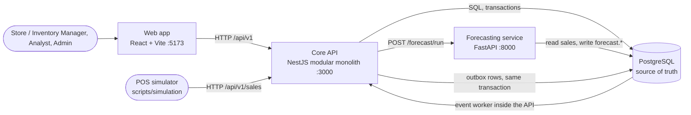
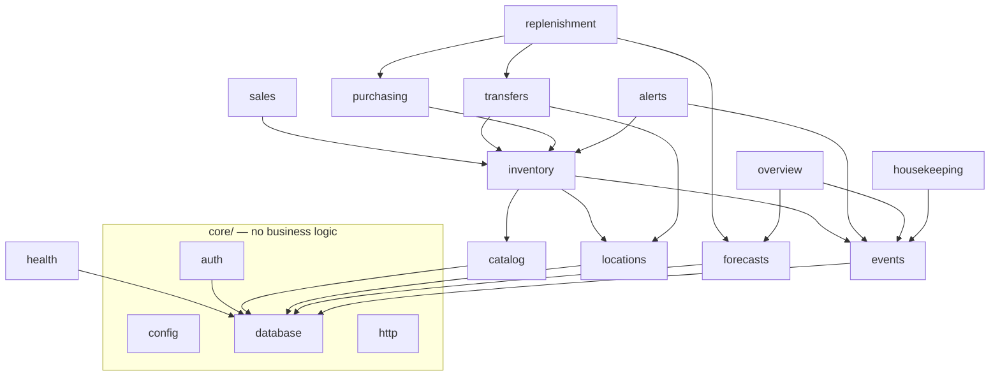
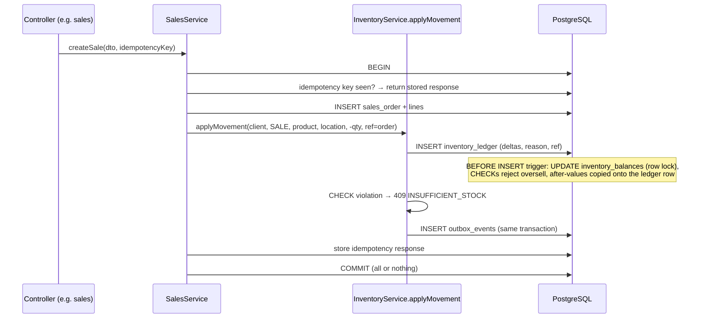
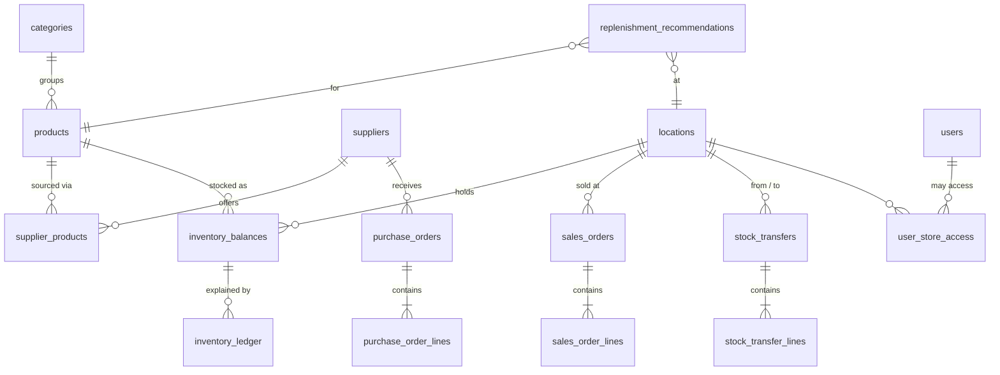
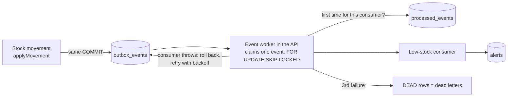
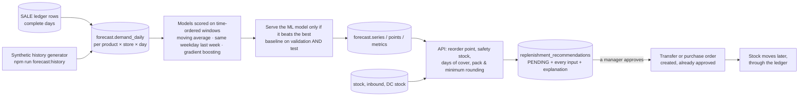

# RetailPulse — Architecture

This is the design every change must follow. If code and this document disagree, fix one of them
in the same change. Diagrams use Mermaid (renders on GitHub and in VS Code's Markdown preview
with the "Markdown Preview Mermaid Support" extension).

> All data is synthetic. RetailPulse is an independent portfolio project.

---

## 1. System context



| Component       | Owns                                             | Never does                                |
| --------------- | ------------------------------------------------ | ----------------------------------------- |
| Web             | UI, form validation for UX, hiding buttons a role cannot use | Business rules, authorization decisions (the API re-checks everything) |
| Core API        | All business rules, all writes to operational data | Long-running ML work                    |
| PostgreSQL      | Truth for stock, orders, ledger, recommendations | —                                         |
| Forecasting     | Demand models, backtests, `forecast.*` tables    | Writing inventory, orders or recommendations |
| Event worker (in the API) | Delivering committed outbox events to consumers | Being required for a sale to succeed |

**Why a modular monolith:** one deployable API keeps transactions simple (a sale, its ledger
entry and its outbox event commit together). Modules give the separation of microservices
without network calls. Forecasting is separate only because it is a different runtime (Python).

---

## 2. Core API internal design

### 2.1 Layers (inside each module)

```text
HTTP request
  → Controller   parse + validate input (Zod), call one service method, map to response DTO
  → Service      business rules, transactions, authorization checks on objects
  → Repository   SQL only (pg). No business rules. Returns plain typed rows.
  → PostgreSQL
```

Rules:

1. **Only repositories contain SQL.** Controllers never touch the database.
2. **Services own transactions** via `DatabaseService.transaction(client => …)` and pass the
   `client` down to repositories so every query runs in the same transaction.
3. **Modules talk through exported services**, never another module's repository.
4. **Request schemas are Zod; response shapes are TypeScript interfaces**, both in
   `<module>.schemas.ts`. Repositories alias columns to the response shape (`on_hand AS "onHand"`);
   raw table rows are never returned.

### 2.2 Module map and allowed dependencies



- Arrows point at what a module may call. **No cycles.**
- **`inventory` is the only module that writes `inventory_balances` and `inventory_ledger`.**
  Sales, transfers, purchasing and adjustments all call `InventoryService.applyMovement()`.
- `overview` is a **read model**: its repository reads across stock, forecast, recommendation and
  alert tables for one landing-page query and writes nothing (decision #42).
- `events` writes the outbox *inside the caller's transaction* (it receives the `client`).
  It knows nothing about its consumers: they register themselves with the `ConsumerRegistry`.

### 2.3 Cross-cutting behaviour (already in place)

| Concern          | Where                                      | Behaviour                                         |
| ---------------- | ------------------------------------------ | ------------------------------------------------- |
| Config           | `core/config/env.ts`                       | Zod-validated at boot; app refuses to start if invalid |
| DB access        | `core/database/database.service.ts`        | One `pg` pool, `query()`, `transaction()`, `ping()` |
| Correlation ID   | `core/http/correlation-id.middleware.ts`   | Accept or create `x-correlation-id`, echo it      |
| Errors           | `core/http/http-exception.filter.ts`       | `{ error: { code, message }, correlationId }`     |
| Versioning       | `bootstrap.ts`                             | Global prefix `/api/v1` (except `/metrics`)       |
| Metrics          | `core/metrics/`                            | Prometheus registry per app; request latency by route **template**; `GET /metrics` (public, counts only) |
| Housekeeping     | `modules/housekeeping/`                    | Hourly: delete processed outbox events and idempotency keys older than 7 days (`HOUSEKEEPING_ENABLED`) |

---

## 3. The inventory write path (the most important flow)

Every stock change, whatever the cause, goes through one function:



Guarantees and how they are enforced:

| Guarantee                         | Enforced by                                                      |
| --------------------------------- | ---------------------------------------------------------------- |
| No oversell under concurrency     | Trigger's `UPDATE` row-locks the balance; CHECKs run on the locked row (tested with two racing sessions) |
| No negative stock                 | `CHECK (on_hand >= 0 AND reserved >= 0 AND reserved <= on_hand)` |
| Every change is traceable         | Balances change **only** via the ledger trigger; a guard trigger rejects direct `UPDATE`/non-zero `INSERT` on `inventory_balances` — enforced by the database, not just by code |
| Ledger can't be rewritten         | DB trigger rejects `UPDATE`/`DELETE` on `inventory_ledger`       |
| Movements go the right direction  | `ledger_delta_matches_type` CHECK (e.g. `SALE` must be negative, `RESERVATION` only touches reserved) |
| Retries don't double-apply        | `idempotency_keys` table, unique per (key, endpoint)             |
| Event exists iff tx committed     | Outbox row in the same transaction; a rolled-back change creates no event (tested) |

Lock ordering: when a movement touches several balance rows (multi-line sale, transfer), lock
them in a fixed order (`product_id, location_id` ascending) to avoid deadlocks.

---

## 4. Data model

Conventions: `uuid` primary keys (`gen_random_uuid()`), `snake_case`, `created_at`/`updated_at`
as `timestamptz` (UTC), quantities as `integer` **units**, money as `numeric(12,2)`, status and
type columns as Postgres enums or `CHECK` lists.



### Tables by day

| Day | Tables                                                                                     |
| --- | ------------------------------------------------------------------------------------------ |
| 1   | `schema_migrations` (runner)                                                               |
| 2   | `categories`, `suppliers`, `products`, `supplier_products`, `locations`, `inventory_balances`, `inventory_ledger` |
| 3 ✅ | `sales_orders`, `sales_order_lines`, `reservations`, `idempotency_keys`                   |
| 4 ✅ | `users`, `user_store_access`, `sessions`, `stock_transfers`, `stock_transfer_lines` (+ ledger `actor_id` FK) |
| 5 ✅ | `outbox_events`, `processed_events`, `alerts`                                             |
| 6 ✅ | `forecast.demand_daily`, `forecast.model_versions`, `forecast.runs`, `forecast.model_metrics`, `forecast.series`, `forecast.points`, `purchase_orders`, `purchase_order_lines`, `replenishment_recommendations` |
| V2 1a ✅ | `forecast.promotions`, `forecast.injected_anomalies`, `forecast.horizon_metrics` (+ `bias`, `interval_coverage`, `interval_width` on `forecast.model_metrics`) |
| V2 1b ✅ | `forecast.interval_calibration`; `lower95`/`upper95` on `forecast.points` (CHECK: nested ranges); `interval95_*` on `forecast.model_metrics` |

### Key table shapes

**`inventory_balances`** — one row per (product, location). PK `(product_id, location_id)`.
`on_hand int`, `reserved int`, `updated_at`. `available` is computed (`on_hand - reserved`), never stored.

**`inventory_ledger`** — append-only. `id`, `product_id`, `location_id`, `movement_type`,
`on_hand_delta int`, `reserved_delta int`, `on_hand_after int`, `reserved_after int`,
`reason text`, `reference_type`, `reference_id`, `correlation_id`, `actor_id`, `occurred_at`.
Invariant (tested): for every balance, `SUM(on_hand_delta) = on_hand` and `SUM(reserved_delta) = reserved`.

| Movement type         | on_hand_delta | reserved_delta |
| --------------------- | ------------- | -------------- |
| `RECEIPT`             | +q            | 0              |
| `SALE`                | −q            | 0              |
| `RETURN` (sellable)   | +q            | 0              |
| `ADJUSTMENT`          | ±q            | 0              |
| `RESERVATION`         | 0             | +q             |
| `RESERVATION_RELEASE` | 0             | −q             |
| `TRANSFER_OUT`        | −q            | 0              |
| `TRANSFER_IN`         | +q            | 0              |

Damaged returns are recorded with `reason = 'DAMAGED'` and `on_hand_delta = 0` (not sellable).

**Inbound** is derived, never stored: sum of open (approved, not received) PO lines and
dispatched-not-received transfer lines for that product and destination.

### State machines

```text
Transfer:        REQUESTED → APPROVED → DISPATCHED → RECEIVED
                 REQUESTED|APPROVED → CANCELLED
Purchase order:  APPROVED → RECEIVED | CANCELLED      (created already APPROVED by a recommendation)
Recommendation:  PENDING → APPROVED (creates transfer or PO) | REJECTED | EXPIRED   (decisions are final)
Forecast run:    RUNNING → SUCCEEDED | FAILED         (one RUNNING at a time)
```

Transitions are checked in the service and guarded in SQL
(`UPDATE … SET status = 'APPROVED' WHERE id = $1 AND status = 'REQUESTED'` → 0 rows ⇒ 409).

---

## 5. API conventions

| Topic          | Rule                                                                         |
| -------------- | ---------------------------------------------------------------------------- |
| Base path      | `/api/v1`                                                                    |
| Naming         | Plural nouns: `/products`, `/locations/{id}`, actions as sub-resources: `/transfers/{id}/approve` |
| Validation     | Zod schema per request; failure → `400 VALIDATION_FAILED` with field details |
| Lists          | `?page=1&pageSize=25` (max 100), `?q=` search, `?sort=field:asc`; response `{ data, page, pageSize, total }` |
| Errors         | `{ error: { code, message, details? }, correlationId }`                      |
| Business errors| `409 INSUFFICIENT_STOCK`, `409 INVALID_STATE_TRANSITION`, `404 NOT_FOUND`   |
| Idempotency    | `Idempotency-Key` header (8–100 chars) required on every stock-changing `POST`: `/sales`, `/receipts`, `/returns`, `/adjustments`, `/reservations` (Day 4+: `/transfers`, `/purchase-orders`). A retry returns the stored response with `Idempotent-Replayed: true`; same key + different body → `422 IDEMPOTENCY_KEY_REUSED`. |
| Auth           | Server-side session in an `HttpOnly; SameSite=Strict` cookie (`Secure` in production), 8 h. A **global guard** requires a session and an allowed role on every route; a route without `@Roles()` is ADMIN-only and a test fails if any route declares neither `@Roles` nor `@Public`. Store managers are further limited to their stores in the service layer. Details: *Roles and access* below. |
| Docs           | The endpoint table below is the reference (a generated OpenAPI page was not built; see decision #47) |

### Endpoints so far

| Method & path                         | Query params                                   | Notes |
| ------------------------------------- | ---------------------------------------------- | ----- |
| `GET /health`                         | —                                              | 503 when DB is down |
| `GET /products`                       | `q, categoryId, sort (sku·name·price·available), page, pageSize` | network totals per product |
| `GET /products/:id`                   | —                                              | includes primary supplier terms |
| `GET /products/:id/stock`             | —                                              | one row per location, `asOf` |
| `GET /products/:id/ledger`            | `locationId, movementType, page, pageSize`     | newest first |
| `GET /categories`                     | —                                              | with product counts |
| `GET /locations`                      | `q, type, sort (code·name·type), page, pageSize` | |
| `GET /locations/:id`                  | —                                              | |
| `GET /locations/:id/stock`            | `q, sort (sku·name·onHand·available), page, pageSize` | `asOf` + location |
| `POST /sales`                         | body `{ locationId, lines:[{productId, quantity}] }` | stores only; prices snapshotted; all-or-nothing |
| `GET /sales/:id`                      | —                                              | |
| `POST /receipts`                      | body `{ locationId, reference?, lines }`       | any location |
| `POST /returns`                       | body `{ locationId, productId, quantity, condition: SELLABLE\|DAMAGED, reason? }` | damaged: logged, not restocked |
| `POST /adjustments`                   | body `{ locationId, productId, delta ≠ 0, reason }` | reason required |
| `POST /reservations`                  | body `{ locationId, productId, quantity, reference? }` | lowers available, not on hand |
| `POST /reservations/:id/release`      | — (no key needed; guarded by status)           | `409 INVALID_STATE_TRANSITION` if not ACTIVE |
| `GET /reservations`, `GET /reservations/:id` | `productId, locationId, status, page, pageSize` | |

| `POST /auth/login` · `POST /auth/logout` · `GET /auth/me` | body `{ email, password }` | login is public and rate-limited; `me` needs a session |
| `POST /transfers`                     | body `{ sourceLocationId, destinationLocationId, notes?, lines }` | Idempotency-Key; status `REQUESTED`; nothing moves |
| `GET /transfers`, `GET /transfers/:id` | `status, locationId, productId, page, pageSize` | detail includes lines and who/when per step |
| `POST /transfers/:id/approve`         | —                                              | admin / inventory manager only |
| `POST /transfers/:id/dispatch`        | —                                              | writes `TRANSFER_OUT` at the source |
| `POST /transfers/:id/receive`         | —                                              | writes `TRANSFER_IN` at the destination |
| `POST /transfers/:id/cancel`          | —                                              | only from `REQUESTED` / `APPROVED` |

Stock reads (`/locations/:id/stock`, `/products/:id/stock`) also return `inbound` per row: units on
`APPROVED` / `DISPATCHED` transfers heading to that location (derived, never stored).

| `GET /alerts`                         | `status, kind, locationId, productId, page, pageSize` | store managers: own stores only |
| `POST /alerts/rescan`                 | —                                              | admin / inventory manager |
| `GET /ops/events`                     | —                                              | backlog, retries, dead letters, worker state — admin / inventory manager |
| `GET /ops/events/dead`                | `page, pageSize`                               | admin / inventory manager |
| `POST /ops/events/:id/replay`         | —                                              | `409 EVENT_ALREADY_PENDING` if still queued |

| `POST /forecasts/run`                 | body `{ horizonDays? }`                        | starts a run in the Python service; `202`; `503 FORECAST_SERVICE_UNAVAILABLE` if it is not running |
| `GET /forecasts/runs/latest`          | —                                              | `{ latest, current, metrics, ranges }`: progress of the newest run, and the newest successful one with accuracy (WAPE, bias, range coverage) and range calibration per sales level |
| `GET /forecasts/series`               | `productId, locationId`                        | history + forecast + 80 % and 95 % ranges + the run's range calibration, for one product at one store |
| `POST /replenishment/generate`        | —                                              | recommendations from the latest forecast; creates **no** transfer/order |
| `GET /replenishment/recommendations`  | `status, action, risk, locationId, productId, page, pageSize` | most urgent first; store managers: own stores |
| `GET /replenishment/recommendations/:id` | —                                           | includes `explanation` and every `inputs` value |
| `POST /replenishment/recommendations/:id/approve` · `/reject` | body `{ note? }`            | approve creates the approved transfer / purchase order |
| `GET /purchase-orders`, `GET /purchase-orders/:id` | `status, locationId, productId, page, pageSize` | |
| `POST /purchase-orders/:id/receive` · `/cancel` | —                                   | receive writes `RECEIPT` movements; cancel is for unreceived orders |

| `GET /overview`                       | —                                              | stock-outs, at risk (7 days), excess (> 60 days of cover), pending recommendations, open alerts, freshness; store managers: own stores |
| `GET /metrics` (no `/api/v1` prefix)  | —                                              | Prometheus text format; public; route templates only, no ids or personal data |

**Overview rules** (`modules/overview/overview.calc.ts`, unit-tested): `position = available + inbound`
(inbound = approved/dispatched transfers + approved purchase orders). *Out of stock*: available ≤ 0
(no forecast needed). *At risk*: available > 0 and position < forecast demand of the next 7 days.
*Excess*: position > 60 × average daily forecast. Positions without a forecast are counted, never
guessed. Thresholds live in `overview.config.ts` and are returned with the response.

### Roles and access

| Capability                                   | Admin | Inventory mgr | Store mgr (own stores) | Analyst |
| -------------------------------------------- | :---: | :-----------: | :--------------------: | :-----: |
| Read catalog, location directory, network totals | ✅ | ✅ | ✅ | ✅ |
| Read per-location stock, ledger, sales, reservations, transfers | all | all | **own stores** | all |
| Sell, receive, return, adjust, reserve, release | ✅ | ✅ | **own stores** | — |
| Request a transfer                           | ✅    | ✅            | **into own store**     | —       |
| Approve a transfer                           | ✅    | ✅            | —                      | —       |
| Dispatch a transfer                          | ✅    | ✅            | **from own store**     | —       |
| Receive a transfer                           | ✅    | ✅            | **at own store**       | —       |
| Cancel a transfer                            | ✅    | ✅            | **touching own store** | —       |
| Run forecasts, generate / approve / reject recommendations | ✅ | ✅ | — | — |
| Read forecasts, recommendations, purchase orders | all | all | **own stores** | all |
| Receive a purchase order                     | ✅    | ✅            | **at own store**       | —       |
| Cancel a purchase order                      | ✅    | ✅            | —                      | —       |

- Role is checked by the global guard (`@Roles(...)`, 403 `FORBIDDEN`); store scope is checked in
  services with `core/auth/access.ts` (403 for a store manager's other stores, filtered rows for lists).
- Network aggregates (product `totalOnHand`/`totalAvailable`) are visible to every role so store
  managers can see where stock exists before requesting a transfer; per-location rows, the
  ledger, sales, reservations and transfers are scoped. Other stores' location totals are `null`.
- Services receive a `RequestContext { correlationId, user }` (the `@Ctx()` decorator) and stamp
  `actor_id` on every ledger row they write.
- Demo accounts (`npm run db:seed`, one shared password from `DEMO_PASSWORD`): `admin@`,
  `inventory@`, `store1@` (STR-01), `store2@` (STR-02), `analyst@` — all `@retailpulse.test`.

Business errors: `409 INSUFFICIENT_STOCK` (with `details`), `409 PRODUCT_INACTIVE`,
`422 INVALID_LOCATION_TYPE`, `422 IDEMPOTENCY_KEY_REUSED`, `409 NO_FORECAST`,
`409 FORECAST_RUN_IN_PROGRESS`, `503 FORECAST_SERVICE_UNAVAILABLE`, `404 NOT_FOUND`.

---

## 6. Events (no message broker)



There is deliberately **no Kafka**: nothing in RetailPulse needs a broker, and the valuable part —
the transactional outbox with idempotent consumers — works on PostgreSQL alone. A broker can be
added later by writing one more consumer that forwards events (see decision #26).

**How one event is processed** (one transaction per event, `EventDispatcher`):

1. Claim the oldest due event (`FOR UPDATE SKIP LOCKED`), so several workers never take the same one.
2. For each consumer of that event type: insert `(consumer, eventId)` into `processed_events`;
   if it already exists the consumer already handled this event → **skip** (idempotent).
3. Run the consumer; its writes happen in the same transaction (a `SAVEPOINT` wraps them).
4. Success: mark the event `PROCESSED` and commit. Failure: roll back to the savepoint (the
   consumer's partial writes disappear), record `attempts + 1`, `last_error` and a backoff
   (2 s, 4 s); after **3** attempts the event becomes `DEAD`.
5. Operators see the backlog on `GET /ops/events`, list `DEAD` events on `/ops/events/dead`, and
   re-deliver one with `POST /ops/events/:id/replay` (consumers that already handled it skip it).

Guarantees: at-least-once delivery, effectively-once effects; a sale never depends on the worker
(with the worker stopped, events simply queue); a "due" brand-new event never depends on the
wall clock (clocks can step backwards — retries are the only clock-based wait).
Not guaranteed: strict ordering (a failing event is retried later while newer ones continue), so
consumers judge **current state**, not the event's numbers.

Envelope:

```json
{
  "eventId": "uuid",
  "eventType": "inventory.movement.recorded",
  "schemaVersion": 1,
  "occurredAt": "2026-01-01T10:00:00Z",
  "correlationId": "uuid",
  "aggregateType": "inventory_balance",
  "aggregateId": "<product_id>:<location_id>",
  "payload": {
    "ledgerId": "123", "productId": "…", "locationId": "…", "movementType": "SALE",
    "onHandDelta": -2, "reservedDelta": 0, "onHandAfter": 6, "reservedAfter": 0,
    "referenceType": "SALES_ORDER", "referenceId": "…", "actorId": "…"
  }
}
```

Payloads carry business data only — no free-text ledger reason, no personal data.
The columns of an event are immutable after insert (a trigger rejects edits); only its
processing state (status, attempts, error) changes.

**Retention:** processed events (and their `processed_events` marks) are deleted after 7 days by
the housekeeping job, in batches, in one statement per batch. Dead and pending events are never
purged. The outbox backlog is exported to Prometheus as `retailpulse_outbox_events{state}` and
`retailpulse_outbox_oldest_pending_seconds`.

### Low-stock alerts (the first consumer)

After every movement the `low-stock-alerts` consumer judges the **current** stock of that
product at that location (`available = on hand − reserved`) and makes the alerts match:

| State                       | Alert                              | Severity |
| --------------------------- | ---------------------------------- | -------- |
| `available ≤ 0`             | `OUT_OF_STOCK`                     | HIGH     |
| `available < one pack`      | `LOW_STOCK`                        | MEDIUM   |
| otherwise                   | none — any open alert is resolved  | —        |

At most one **OPEN** alert exists per product, location and kind (a partial unique index), so
duplicate or concurrent processing cannot create two. Each alert stores its inputs
(`available`, `onHand`, `reserved`, `packSize`, the event) so the UI can answer "why?".
`POST /alerts/rescan` re-checks every low position (use it after loading data that did not go
through events, such as the seed). Day 6 replaces "one pack" with a forecast-based reorder point.

---

## 7. Forecasting & replenishment



**Rules that hold everywhere** (each one is tested):

- The Python service reads sales history and writes **only** the `forecast` schema. A test scans
  its source for every `INSERT/UPDATE/DELETE/COPY` and fails if one targets another schema, and a
  database test proves a full run changes no stock, order, transfer or event.
- A forecast is advice. **Nothing is ordered or moved until a person approves a recommendation**;
  *generating* recommendations creates no document and no stock movement (tested).
- Every recommendation stores every input and the calculation in words, so the UI can show why.

### 7.1 Forecasting service (`services/forecasting`, Python)

| Step | What happens |
| ---- | ------------ |
| History | `forecast.demand_daily`: units per product × store × day. `SYNTHETIC` rows come from a seeded generator (`python -m app.synthetic`: category base × product popularity × store size × weekday pattern × yearly season × trend × promotions, negative-binomial noise, a few slow movers and new products). The generator also stores its promotion calendar (`forecast.promotions`) and, by default, injects **labelled** anomalies — one-day spikes and 3-day drops to zero in 12 % of series, never on promotion days — into `forecast.injected_anomalies` as ground truth for anomaly detection (`--anomaly-share 0` turns them off). `LEDGER` rows are rolled up from real SALE movements of complete (UTC) days and win over synthetic rows for the same day. |
| Windows | The last 28 days are the **test** window, the 28 before it the **validation** window, everything earlier is training. Models are scored 1–7 days ahead from rolling origins every 7 days, so each window day is predicted once from earlier data only. |
| Models | `moving_average_28` (mean of the last 28 days), `seasonal_naive_7` (same weekday of the latest known week), `hgb_direct` (one global scikit-learn `HistGradientBoostingRegressor`, Poisson loss, direct multi-horizon; features are lags/means/std/same-weekday values at the origin, horizon, calendar, category/store as numeric codes, and the promotion calendar: uplift planned for the target day plus promotion days in the last 7 — all other values computed from data up to the origin). No native categorical splits, so tree explanations are exact (decision #48). The ML model is retrained for each split on data *before* that split. |
| Metrics | MAE, RMSE, WAPE (total error ÷ total units sold) and **bias** (Σ(forecast − actual) ÷ Σ actual), pooled over series with enough history, for every model on validation and test; the same per horizon day in `forecast.horizon_metrics`; and the 80 % range's **coverage and width** on the test window, built from validation errors only. All persisted per run. |
| Selection | The best baseline is chosen on **validation**. The ML model is served only if its WAPE beats that baseline on **both** validation and the untouched test window; otherwise the baseline is served and the run says so. |
| Low history | Series with fewer than 56 observed days use the **category × store average**, flagged `is_fallback` (shown in the UI, never presented as a model forecast). |
| Uncertainty | **80 % and 95 % ranges from measured errors** (split conformal, V2 1b, `evaluation/intervals.py`): residuals (actual − forecast) of the served model are grouped by forecast level (0–0.5, 0.5–1, 1–2, 2–4, 4–8, 8+ units/day) and their 10/90 % (2.5/97.5 %) quantiles are added to the forecast, never below 0 and always containing the forecast. Coverage is checked honestly — calibrated on validation, scored on test — overall and per level group (`forecast.interval_calibration`); live ranges use both windows. Replaces the Day-6 ± 1.28 σ band, which held 91 % for slow sellers and 78 % for fast ones. The UI states the range in words with its measured reliability. |
| Persistence | `forecast.runs` (windows, served model version, selection reason, data label), `model_versions`, `model_metrics`, `series`, `points`. One run at a time (unique index); a run abandoned for 30 minutes is marked failed; the newest 5 runs are kept. |
| API | `POST /forecast/run` (202, runs in the background), `GET /forecast/runs/latest`, `GET /forecast/runs/{id}`, `GET /forecast/{sku}/{store}`. **No authentication of its own: run it on localhost / a private network only.** |

### 7.2 Replenishment (`modules/replenishment`, TypeScript, pure arithmetic)

```text
demandDuringLead = forecast units over the next L days   (beyond the horizon: the horizon's average)
safetyStock      = z × σ_daily × √L            z = 1.645 (≈ 95 % service level)
reorderPoint     = demandDuringLead + safetyStock
orderUpTo        = forecast units over L + R days + safetyStock                R = review period, 7 days
position         = available + inbound         available = on hand − reserved;
                                               inbound = approved/dispatched transfers + approved orders
needed when position < reorderPoint;  quantity = orderUpTo − position
rounded UP to whole packs (purchase orders: at least the supplier minimum, in whole packs)
```

- **Source:** a distribution centre with unallocated stock (lead time 2 days) when it can cover the
  whole quantity — otherwise the primary supplier (its lead time and minimum). A centre that has
  some stock but not enough is reported in the explanation ("DC-NORTH has 4, 84 needed").
- **Scarce DC stock is never promised twice:** recommendations are produced most-urgent-first
  (lowest days of cover) and each transfer takes its quantity out of what later stores may use;
  stock already promised to open (requested/approved) transfers is excluded.
- **Risk:** `CRITICAL` if nothing is available or the position will not last the lead time,
  otherwise `HIGH` (below the reorder point but lasting the lead time).
- **Approval** (admin / inventory manager): creates the **transfer already APPROVED** or the
  **purchase order (APPROVED)** in the same transaction and links it. Stock moves later — dispatch
  and receipt of the transfer, receipt of the order, each through `applyMovement()`. Approving twice
  is a `409`; five simultaneous approvals create exactly one document (tested).
- **Regenerating** expires the previous pending recommendations (one pending per product × store,
  enforced by a partial unique index) and counts approved-but-unreceived stock as inbound.

### 7.3 Measured accuracy (synthetic data — not a claim about real retail)

Re-measured in V2 step 1a with `npm run forecast:measure`, which rebuilds exactly the dev history
in memory (real catalog: 200 products × 5 stores, 365 days, seed 42, with the promotion calendar
and 151 labelled anomaly days injected) and runs the full evaluation. 950 of 1,000 series had
enough history; test window = the last 28 days, scored 1–7 days ahead.

| Model | WAPE (validation) | WAPE (test) | Bias (test) | 80 % range held (test) | 95 % range held (test) | 80 % width |
| ----- | ----------------: | ----------: | ----------: | ---------------------: | ---------------------: | ---------: |
| Noise floor: knowing the true expected demand (only possible with synthetic data) | — | 51.0 % | — | — | — | — |
| **Gradient boosting, V2 features (served)** | 50.9 % | **51.6 %** | +0.1 % | **80.0 %** | **94.9 %** | 4.94 units |
| Gradient boosting, Day 6 features (for comparison) | 51.4 % | 52.2 % | +0.3 % | — | — | — |
| Moving average, 28 days | 53.7 % | 54.4 % | +2.7 % | 81.3 % | 95.7 % | 5.12 units |
| Same weekday last week | 70.4 % | 71.3 % | +1.1 % | 87.7 % | 97.8 % | 6.02 units |

Range coverage per forecast level (served model, test window, 80 % / 95 %): 0–0.5 units/day
84.2 / 94.8 % · 0.5–1: 79.6 / 95.3 % · 1–2: 78.5 / 93.8 % · 2–4: 80.0 / 94.9 % · 4–8: 81.3 / 95.5 % ·
8+: 80.9 / 95.7 %. The Day-6 band (± 1.28 σ) on the same forecasts held 83.4 % overall but 91.1 %
for 0–0.5 and 78.4 % for 8+ (measured once with a diagnostic in step 1b; the reason is tested in
`tests/test_intervals.py`). Slow sellers stay above 80 % because sales of 0 or 1 unit leave no
narrower honest range.

Gradient boosting test WAPE by days ahead (1 → 7): 53.5 · 52.3 · 52.6 · 50.2 · 47.2 · 53.3 · 54.8 %
(it varies with the weekday mix of each horizon more than with distance).

Reading it: with daily sales of 1–5 units most of the error is unavoidable randomness, so a ~51 %
floor is expected. The V2 model is **0.6 points** from that floor and **2.8 points** better than
the best simple method; the Day 6 model was 1.2 points from the floor. The gain comes from the
**promotion calendar**: re-encoding category/store as numeric codes alone changed nothing
(52.2 → 52.3 % with one-hot, 51.6 % codes vs 51.6 % one-hot once promotions are added).
Bias is close to zero. Since step 1b the 80 % and 95 % ranges hold their level within ±2 points
overall and in every sales-level group except the slowest (see above). A run takes ~35–40 s for 1,000 series
on a laptop (Day 6 encoding: ~30 s). Re-measure whenever the models or the generator change.

Two honest caveats about the promotion feature: (1) promotions are synthetic and their effect is a
known ×1.6, so the gain is easier here than with real promotions; (2) no promotions are planned for
the forecast horizon, so live forecasts never use it — it mainly keeps promotion spikes from
distorting what the model learns.

**Limitations:** accuracy is measured 1–7 days ahead (days 8–14 of the forecast are not scored);
demand is not censored by stock-outs; one global model, no per-series tuning; the service has no
authentication; recommendations assume the primary supplier and one lead time per product.

---

## 8. Folder structure

Legend: ✅ exists now · `(Dn)` added on day n. Don't create folders before they're needed.

```text
RetailPulse/
├── AGENT.md                         rules + 7-day plan for AI agents
├── README.md                        what it is + quick start
├── docs/
│   └── ARCHITECTURE.md ✅           this file
├── docker-compose.yml ✅            postgres; profiles `full` (whole app) and `observability`
├── .dockerignore ✅
├── ops/observability/ ✅           prometheus.yml, grafana/ (datasource + one dashboard JSON)
├── .env.example ✅
├── package.json ✅                  npm workspaces + root scripts
├── eslint.config.mjs ✅  .prettierrc.json ✅
├── .github/workflows/ci.yml ✅
│
├── services/
│   ├── api/                         NestJS core API
│   │   ├── Dockerfile ✅            multi-stage: build → prod deps → runtime (non-root)
│   │   ├── migrations/ ✅           0001_init.sql, 0002_….sql (never edit applied files)
│   │   ├── scripts/
│   │   │   ├── migrate.mjs ✅       migration runner
│   │   │   └── seed.mjs ✅          deterministic synthetic demo data (--reset)
│   │   ├── src/
│   │   │   ├── main.ts ✅           entry point: load env → create app → listen
│   │   │   ├── bootstrap.ts ✅      shared wiring (prefix, middleware, filters)
│   │   │   ├── app.module.ts ✅     imports core + feature modules
│   │   │   ├── core/                cross-cutting, no business logic
│   │   │   │   ├── config/ ✅       env.ts
│   │   │   │   ├── database/ ✅     database.module.ts, database.service.ts, sql.ts
│   │   │   │   ├── http/ ✅         correlation-id, exception filter, zod pipe, query.ts (page/sort)
│   │   │   │   ├── auth/ ✅         session guard, roles decorator, store-access helpers
│   │   │   │   ├── idempotency/ ✅  Idempotency-Key handling (+ purge of old keys)
│   │   │   │   └── metrics/ ✅      Prometheus registry, request-latency middleware, GET /metrics
│   │   │   └── modules/             one folder per business domain
│   │   │       ├── health/ ✅
│   │   │       ├── catalog/ ✅      products, categories, supplier terms
│   │   │       ├── locations/ ✅
│   │   │       ├── inventory/ ✅    stock + ledger reads; (D3) applyMovement()
│   │   │       ├── sales/ ✅
│   │   │       ├── reservations/ ✅
│   │   │       ├── transfers/ ✅    request → approve → dispatch → receive / cancel
│   │   │       ├── auth/ ✅         login, logout, me, login throttle
│   │   │       ├── events/ ✅       outbox writer, worker (dispatcher), retries, dead letters, ops endpoints
│   │   │       ├── alerts/ ✅
│   │   │       ├── forecasts/ ✅    reads forecast.*, starts runs in the Python service
│   │   │       ├── purchasing/ ✅   purchase orders (created by approving a recommendation)
│   │   │       ├── replenishment/ ✅ calc (pure), recommendations, approve / reject
│   │   │       ├── overview/ ✅     read model for the landing page (calc is pure)
│   │   │       └── housekeeping/ ✅ hourly cleanup of processed events and old idempotency keys
│   │   └── test/
│   │       ├── app.spec.ts ✅       HTTP tests with a mocked DB
│   │       └── integration/ ✅      *.int-spec.ts, each in its own throw-away database
│   │
│   └── forecasting/                 FastAPI + ML
│       ├── app/
│       │   ├── main.py ✅           FastAPI app + routes (runs in a background thread)
│       │   ├── pipeline.py ✅       compute() (pure) + run_forecast() (DB)
│       │   ├── repository.py ✅     every SQL statement; writes only to `forecast.*`
│       │   ├── data.py ✅           history → (series × days) matrix
│       │   ├── db.py, config.py ✅  connections (reads are READ ONLY), settings
│       │   ├── models/ ✅           baselines.py, ml.py
│       │   ├── evaluation/ ✅       backtest.py (windows, selection, horizon + range scoring), intervals.py (conformal ranges), metrics.py, report.py (npm run forecast:measure)
│       │   └── synthetic/ ✅        generator.py, load.py, __main__.py (npm run forecast:history)
│       ├── tests/ ✅                73 tests: leakage, windows, selection, DB run, write guard, API
│       ├── Dockerfile ✅            multi-stage: virtualenv → runtime (non-root)
│       ├── pyproject.toml ✅        ruff + pytest config
│       └── requirements*.txt ✅     pinned
│
├── apps/
│   └── web/                         React + Vite + Tailwind
│       ├── Dockerfile, nginx.conf ✅ static build served by unprivileged nginx; proxies /api only
│       ├── e2e/ ✅                  Playwright happy path + start-api.mjs (own <db>_e2e database)
│       ├── playwright.config.ts ✅
│       └── src/
│           ├── main.tsx ✅          entry
│           ├── App.tsx ✅           layout shell (header, nav, page outlet)
│           ├── api/ ✅              client.ts (fetch + error handling), types per domain
│           ├── components/ ✅       Badge, Status (loading/error/empty/asOf), Pagination, table.ts
│           ├── lib/ ✅              router.ts (hash routes), useAsync.ts, format.ts
│           └── pages/ ✅            Overview (landing), Products, ProductDetail, Stock, Transfers, Alerts, Replenishment, Purchase orders, Health
│
└── scripts/simulation/ ✅
    ├── pos-sim.mjs                  POS traffic simulator (npm run sim:pos; signs in)
    ├── demo.mjs                     npm run demo: POS traffic, alert re-scan, forecast, recommendations
    └── measure.mjs                  npm run measure: sequential read-latency percentiles
```

### Module file convention (API)

```text
modules/inventory/
├── inventory.module.ts       Nest module: providers + exports
├── inventory.controller.ts   HTTP only
├── inventory.service.ts      rules + transactions
├── inventory.repository.ts   SQL only
├── inventory.schemas.ts      Zod request schemas + response interfaces
└── inventory.service.spec.ts unit tests next to the code
```

### Naming

| Thing              | Convention                       | Example                         |
| ------------------ | -------------------------------- | ------------------------------- |
| TS files           | `kebab-case.<role>.ts`           | `stock-transfer.service.ts`     |
| Classes            | `PascalCase`                     | `InventoryService`              |
| DB tables/columns  | `snake_case`, plural tables      | `inventory_balances.on_hand`    |
| JSON fields        | `camelCase`                      | `onHand`, `locationId`          |
| Migrations         | `NNNN_verb_subject.sql`          | `0002_create_catalog.sql`       |
| Error codes        | `UPPER_SNAKE`                    | `INSUFFICIENT_STOCK`            |
| Env vars           | `UPPER_SNAKE`                    | `DATABASE_URL`                  |

---

## 9. Testing strategy

| Level              | Tool                       | What                                                  | When it runs |
| ------------------ | -------------------------- | ----------------------------------------------------- | ------------ |
| Unit               | Jest / Pytest              | Pure rules: reorder point, state transitions, rounding | every check |
| HTTP               | Jest + Supertest (mock DB) | Routing, validation, error shape                       | every check |
| Integration        | Jest + real Postgres       | Constraints, concurrency, rollback, idempotency        | CI + locally with DB up |
| E2E ✅             | Playwright                 | One happy path through the UI (`npm run test:e2e`, own `<db>_e2e` database) | CI + locally |
| Images ✅          | `docker build` in CI       | The three demo images keep building                    | CI |

Inventory tests listed in AGENT.md §9 are mandatory before Day 3 is done.

---

## 10. Decision log

| # | Decision | Why | Trade-off |
| - | -------- | --- | --------- |
| 1 | PostgreSQL as the only operational DB | Transactions, row locks, constraints, `SKIP LOCKED` | Single node in MVP |
| 2 | Modular monolith API | Atomic transactions without distributed coordination | Modules must stay disciplined (rules in §2) |
| 3 | Plain SQL + `pg`, no ORM | Locking/ledger SQL stays explicit and reviewable | More typing of row types |
| 4 | Own tiny migration runner | No dependency; checksums stop edited migrations | Fewer features than big tools |
| 5 | Integer unit quantities | No fractional stock in this domain | Weight-based items out of scope |
| 6 | Ledger deltas + after-values | Balance is provable from the ledger | Slightly larger rows |
| 7 | Transactional outbox | Event iff commit; the worker being down never blocks a sale | Delivered by a worker (see #26) |
| 8 | Forecasting writes only `forecast.*` | ML can't mutate operational data | API must read forecast tables |
| 9 | npm workspaces, one lockfile | Simple, built in | No task caching |
| 10 | NestJS 12 with `module: nodenext` | Nest 12 is ESM-only; matches official template | Jest needs `--experimental-vm-modules` |
| 11 | Balances maintained by a ledger trigger (Day 2) | The DB itself guarantees balance = Σ ledger, even for scripts/SQL that bypass the API | Logic lives partly in SQL; covered by integration tests |
| 12 | Hash router + `useAsync` hook in the web app | Five screens don't justify a router/data library | Revisit if the UI grows a lot |
| 13 | Integration tests use separate databases (refined by #32: one per test file) | Tests never touch dev data; reseeded per test file | Needs Postgres running (`npm run db:up`) |
| 14 | Idempotency key row lives in the same transaction as the work (Day 3) | A failed request leaves no key, so it can be retried; concurrent duplicates wait, then replay | Keys accumulate; a cleanup job is planned (Day 7) |
| 15 | Multi-line writes lock balance rows in `product_id` order | Prevents deadlocks between concurrent multi-line sales (tested) | Callers must use `sortByProduct()` |
| 16 | Damaged returns write a ledger row with `on_hand_delta = 0` and the quantity in the reason text | Keeps the ledger complete without making damaged goods sellable | Damaged quantity is not queryable as a number yet |
| 17 | ~~Write endpoints unauthenticated until Day 4~~ | Superseded by #19 — every route now needs a session and a role | — |
| 18 | scrypt (built into Node) for password hashing | Memory-hard, no native dependency to compile; params stored per hash so they can be raised | Not argon2; revisit if a prebuilt argon2 is wanted |
| 19 | Server-side sessions; only a SHA-256 of the token is stored; `SameSite=Strict` cookie | Instant logout/disable, a DB leak yields no usable sessions, CSRF mitigated without tokens | One DB lookup per request |
| 20 | Deny-by-default global guard + route-coverage test | A forgotten decorator can never expose a route | Every new route must declare `@Roles` or `@Public` |
| 21 | Store scope enforced in services via `core/auth/access.ts` | Same helper for reads (filter) and writes (403); testable with real data | Services take a `RequestContext` |
| 22 | In-memory login throttle (5 failures / 15 min per email + IP) | Simple and enough for one instance | Resets on restart, not shared across instances — move to PostgreSQL/Redis before scaling out |
| 23 | Approval does not reserve stock; dispatch fails with `INSUFFICIENT_STOCK` if the source ran short | Keeps transfers simple; stock stays sellable until it physically leaves | A sale can consume stock between approval and dispatch |
| 24 | Transfers send and receive the full requested quantity | No partial-delivery workflow in the MVP; shortages are fixed with an adjustment | No per-line discrepancy tracking |
| 25 | Transfer status order is enforced by a DB trigger + CHECK, not only by the service | No code path or manual SQL can skip a step | Logic partly in SQL; covered by tests |
| 26 | **No Kafka**: PostgreSQL outbox + a worker inside the API (user decision, Day 5) | No extra container or ~1 GB of RAM; nothing here needs a broker; the outbox/idempotent-consumer pattern is the same | Only in-process consumers; to feed another system later, add a consumer that publishes to a broker |
| 27 | One transaction per event: claim → consumers → mark processed (`SAVEPOINT` around consumers) | A consumer's writes and "handled" commit or roll back together; a failure leaves no partial effect | Events are processed one at a time per worker |
| 28 | `processed_events (consumer, event_id)` makes consumers idempotent | Replays and duplicates are harmless (tested, incl. 3 concurrent workers) | Table grows; cleanup with the outbox (Day 7) |
| 29 | Dead letters are `DEAD` rows in `outbox_events`, not a second table | One place to monitor and replay; no copying | Listing dead events filters the same table |
| 30 | Alerts judge *current* stock, not the event's numbers | Correct even if events arrive late or out of order; re-processing is harmless | One extra read per event |
| 31 | A never-attempted event is due immediately; only retries wait on the clock | The test machine's clock stepped backwards (up to ~480 ms) and freshly created events looked "in the future" — found by stress-testing | Retry backoff can be a little longer after a backwards clock step |
| 32 | Integration tests use one throw-away database per test file | Two test runs at once (yours, CI, an editor) used to wipe each other's data; found while chasing flaky tests | ~3 s extra setup per file |
| 33 | Forecasting is a separate Python service that writes only the `forecast` schema | Different runtime (numpy / scikit-learn); the "never touches stock or orders" rule is checked by a source scan and a DB test | Needs to be started (`npm run forecast:serve`); no auth of its own → localhost only |
| 34 | Time-ordered validation + untouched test window; ML served only if it beats the best baseline on both | No future data in training or selection; the ML model must earn its place | Needs ≥ 112 days of history; accuracy measured at 1–7 days ahead |
| 35 | One global gradient-boosting model, direct multi-horizon, Poisson loss | Handles many small series, count data and short histories without per-series tuning | Less accurate than a model that knows each series' quirks; modest gain over the baseline (see §7.3) |
| 36 | Low-history series use a flagged category × store average | Honest about uncertainty instead of extrapolating 30 days | Flat forecast, no weekday shape |
| 37 | Replenishment is plain, explainable arithmetic, not ML | A manager can check it by hand; ML only supplies the demand numbers | Fixed 95 % service level and 7-day review period (constants, stored with every recommendation) |
| 38 | Most-urgent-first allocation of scarce DC stock | Two stores are never promised the same units | Greedy, not optimal across stores |
| 39 | Approving a recommendation creates an already-approved transfer / purchase order | The manager's decision is the approval; no second click | Stock still moves only at dispatch/receipt, so there can be a delay |
| 40 | Purchase orders exist only via recommendations (no manual PO form yet) | Keeps one audited path; matches "ML never orders by itself" | Manual ordering is a later feature |
| 41 | `forecast.runs` has a unique index on `(true) WHERE status = 'RUNNING'` | One run at a time without a lock service | A crashed run blocks new ones for up to 30 minutes (then auto-failed) |
| 42 | `overview` is a read-only read model with its own cross-domain SQL (Day 7) | One fast query set for the landing page (p95 24 ms measured) instead of many service calls | It reads other modules' tables; it must never write, and its rules are re-stated in `overview.calc.ts` |
| 43 | Overview thresholds: at risk = position below 7 days of forecast; excess = more than 60 days of cover | Simple, explainable, printed on the page | Not tuned per category; slow movers with a near-zero forecast show as excess |
| 44 | Prometheus metrics via `@prometheus-io/client` (the maintained successor of `prom-client`), one registry per app, route **templates** as labels | Bounded label cardinality, no ids in metrics; tests can build several apps | `/metrics` is public — keep it off the public proxy (the web container does not forward it) |
| 45 | Housekeeping in the API (hourly timer), 7-day retention for processed events and idempotency keys | Tables stopped growing without another service or cron container | A retry with the same key after 7 days is treated as new (tested and documented) |
| 46 | Compose profiles `full` and `observability`; ports bound to 127.0.0.1; forecasting not published | One command for a full local demo; Prometheus/Grafana stay optional | Not a deployment: no TLS, shared demo password, anonymous Grafana viewer |
| 47 | No generated OpenAPI page | It would need either decorators on every route or a hand-kept route list; the endpoint table here is reviewed with each change | API consumers read this document instead of an interactive spec |
| 48 | Category and store enter the model as numeric codes, not native categorical splits (V2 1a) | A spike showed SHAP's TreeExplainer returns non-additive (wrong) values for native categorical splits; codes keep it exact. Measured: same test WAPE as one-hot and as Day 6 | A tree needs several splits to isolate one store; harmless at this size |
| 49 | The promotion calendar is a known input for the target day | Promotions are planned in advance, like the calendar; without it the model learns promotion spikes as noise | Synthetic promotions are easy to model (fixed ×1.6); none are planned for the live horizon |
| 50 | Anomalies are injected with labels on a separate random stream | Detection can be measured (precision/recall) and every other day keeps the value it had before | The injected kinds (spike, 3-day drop) are simpler than real anomalies |
| 51 | Forecast ranges by split conformal, grouped by forecast level (V2 1b) | Uses the model's real errors, no normal assumption; skewed counts get asymmetric ranges; coverage is checked on data the calibration never saw | Assumes the coming weeks resemble the calibration weeks; days 8–14 reuse the 1–7-day quantiles; the daily ranges cannot be summed into a range for a total |

